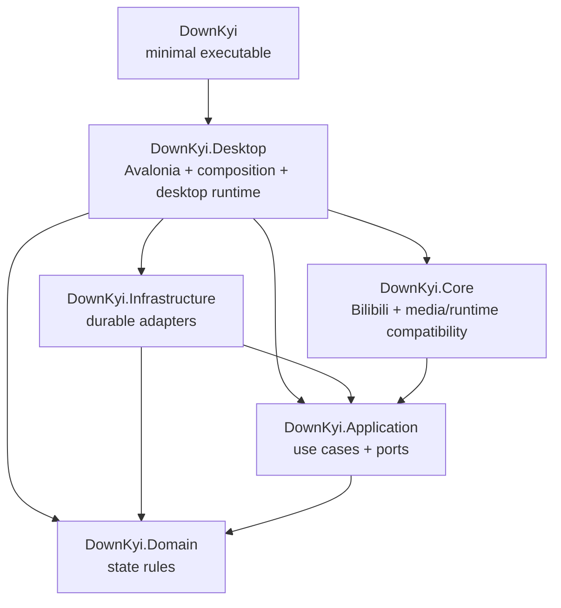
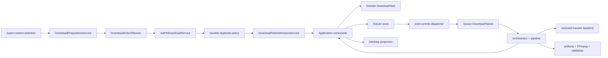

# DownKyi Architecture

本文件只保存 current owner、依賴方向、不能從程式碼直接推導的 invariant，以及對應的可執行防線。具體類別清單、呼叫順序與數量以 current code 和 audit 結果為準；若兩者不一致，在同一 PR 修正本文件。

## 閱讀入口

1. 從 `src/DownKyi.Desktop/Composition/DesktopComposition.cs` 找產品組裝。
2. 跟進受影響模組的 local composition、contract、constructor 與 focused tests。
3. 需要正式命令時只讀 `docs/operations/verification-and-rollback.md`。
4. 目前工作只從 [DownKyiCore 工作項目](https://github.com/users/crazysmile-PhD/projects/2) 選取；單一工作的背景、scope、evidence 與驗收看其 linked Issue，完成歷史看 Project、Git、PR 與 `CHANGELOG.md`。

領域路由見 `docs/maintenance.md`；仍有效的設計理由見 `docs/design-docs/README.md`。

## Current owner map

- `DownKyi` 只含最小 `Program` bootstrap，只引用 Desktop；不得擁有 UI、套件、資源或生命週期。
- `DownKyi.Desktop` 擁有 Avalonia App、Views、ViewModels、UI projections、desktop adapters、Host composition、導航／對話框與下載 runtime。`DesktopThemeController` 是唯一 theme switch owner；semantic tokens 由 `DesignTokens.axaml` 擁有。
- `DownKyi.Application` 擁有 use cases，以及 Bilibili HTTP、cookie／buvid、logging、physical output path 等 ports。
- `DownKyi.Domain` 的 `DownloadTask` 是 durable state transition 的權威。
- `DownKyi.Infrastructure` 擁有 SQLite、async Bilibili transport、single-flight buvid、write-behind、physical path resolver 與 private logging sink／retention／exporter。
- `DownKyi.Core` 必須保持 headless；Bilibili DTO／protocol、FFmpeg 與部分 filesystem compatibility 目前仍在此。把後兩者搬到 Infrastructure 是 ownership 方向，不是已完成事實。

Prism、DryIoc、EventAggregator、RegionManager、ContainerLocator、第二個 router／container 或 service locator 都不得重新引入。否則會產生平行生命週期、導航狀態或依賴解析 owner。

## Composition 與外部協定

Desktop composition root 只選擇模組；Navigation／Dialog／Download 的實作、生命週期和多介面 alias 由各自 local composition 接合。`DownKyiHost` 預設仍驗證必要依賴與 lifetime；Release 產品啟動只解析當下路徑所需服務，完整 composition 由測試驗證。主視窗先顯示不含功能狀態的最小 shell，第一幀後才解析 `MainWindowViewModel` 並導向首頁；這只縮短 first-visible path，不改變 navigation、diagnostic 或 readiness 的 owner。這些驗證仍不能取代產品組裝與行為測試。

Bilibili endpoint adapters 留在 `DownKyi.Core/BiliApi` 以維持 DTO 與協定相容。所有 production 呼叫必須使用注入的 async port：普通 API 經 `IBilibiliApiClient`；QR 登入由同一個隔離 `IBilibiliLoginSession` 貫穿 generate、poll 與 trusted callback，以保留 response cookies。Host 是 client、session factory、cookie、buvid 與 network settings 的唯一組合點；不得恢復 static client、global `Configure()` 或同步 HTTP compatibility path。

## Navigation 與 UserSpace invariant

- ViewModel／caller 只依賴 Application 的 `IAppNavigationService` 與 `IAppDialogService`。只有 local composition 的 factories 可依 typed enum 選擇已註冊的 transient View／ViewModel；adapter 不得持有 container。
- Main-region back 必須先縮減既有 history 並恢復原 View／ViewModel instance；只有沒有 history 時才建立 typed parent route。違反會遺失頁面、查詢與選取狀態。
- UserSpace 公開收藏由單一 coordinator 映射成 snapshot；返回相同 MID 時保留原頁面與清單。失效收藏仍可辨識，但不可選取、開啟或加入下載。
- 裸 `/list/<MID>` 使用 `PublicationNavigationPayload` 表示全部投稿；帶正整數 `sid` 的 URL 使用獨立 `SeriesNavigationPayload` 載入指定系列。無效 `sid`、API failure 或 MID／series identity 不匹配都 fail closed，不得退回全部投稿。
- 投稿分頁以 WBI `page.count` 為準；收藏的 `media_count` 不是 filtered count，只能依 `has_more` 擴展。返回時保留 query、頁碼與既有 media instances；只有被取消的未完成頁補載。
- 可變 `PathIconData` geometry 必須由 factory 為各 ViewModel 建立獨立 instance，避免主題更新污染其他頁面。

## Download invariant

### Durable state

- 對既有 task 的 durable command 必須先載入 aggregate、執行合法 transition、以 optimistic version 寫入 SQLite，再發布 committed snapshot。若先更新 UI，crash 後 UI 與可恢復狀態會分裂。
- 新 task 必須先持久化，才能加入 UI projection 或交給 queue。commit 完成後，原始 UI caller 的 cancellation 不得遺棄 handoff；queue runtime 不可用時由 post-commit dispatcher 持久化 typed failure，不能留下沒有 durable 結果的 task。
- Runtime 不得從 mutable UI model 或 lossy history 重建 Domain task。`DownloadTask.Restore` 只允許 SQLite materializer 與 legacy migration adapter 使用。
- 使用者要求的 audio／video／danmaku／subtitle／cover 由 Domain `DownloadContentSelection` 表達；舊字串 map 只存在於 dialog、SQLite 與 NRBF compatibility boundary。
- 選擇與執行必須保留四個不同語義：`Requested` 是使用者意圖、`Available` 是已知資源能力、`Finalized` 是使用者確認後可建立 task 的動作、`Result` 是檔案執行證據。不得用 playback presence、空集合或 null 同時代替這些狀態。
- `DownloadPreparationService` 只有在 requested content 含 media 時查詢 playback／quality；subtitle／danmaku／cover-only 準備仍可取得必要 metadata，但不得觸發 media stream discovery。
- `PreparedDownload` 以允許的輸出組合描述 media capability，而不是把 audio／video presence 當成可獨立選擇。DURL 只支援 video-only 與 audio+video，不支援 audio-only；`DownloadActionPlanner` 是 page selection 與 finalized action 的唯一 owner，空 selection 不得建立 task。`DownloadContentConflictResolver` 只處理 media capability／quality 衝突；media 不可用時保留獨立動作，並由明確的 continue／skip 決策收斂。同一下載操作中的純 lower-quality substitutions 必須在 task 入列前由 planner 收集，顯示一次含每頁實際替代品質的 batch decision；接受或略過只能作用於該畫面列出的頁面，其他類型的 content conflict 不得被這個批次決策吞掉。後續 refresh 不得改變已確定的 transport、quality、codec 或 audio／video intent。
- `DownloadActionClaims` 只描述實體輸出占用、SQLite admission 與 reservation-key 恢復共用的 action-level 契約；固定粒度為 media、subtitle、danmaku ASS、danmaku XML、cover、NFO。SQLite 必須由 persisted `DownloadContentSelection` 與 `nfo_request` 重建同一組 claims。
- `DownloadTaskAdmissionService` 是唯一的下載判重 owner，並在同一個 serialized admission boundary 內檢查 persistence-backed active task 與 completed history。身份只有 CID 加五個頂層內容選項（音訊、影片、彈幕、字幕、封面）；畫質、codec、路徑、字幕軌與檔案是否仍存在都不參與判斷。一般下載略過相同完成紀錄；明確的重新下載只忽略完成紀錄，仍不允許建立相同的 active task。`DownloadListState` 與 UI collections 都只是 projection，不能作為重複證據。
- output admission 必須使用 `IPhysicalOutputPathResolver`，以同一實際路徑識別 symlink／alias。資料庫啟動投影只比較表與欄位，不重新解讀舊記錄的輸出路徑或 reservation key。不同 CID 的重疊 claim 由前置路徑分配與 admission transaction 拒絕；重新解析出的 resolution、codec 或 transport 差異不是新的 media action，需要不同媒體規格時使用明確的重新下載策略。投影無法保留既有資料時必須保留原庫備份，並只在使用者明確確認後建立空白資料庫。
- 通知只由發起操作的 ViewModel 依 counts 與 planning stop reason 發布一次，policy 不擁有通知。
- 啟動恢復、新增與續傳只傳 `DownloadTaskId`，不得輪詢 UI collection。啟動查詢同時提供 Domain snapshots 與 projections；runtime decision 只用前者。

### Execution 與 retry

- `DownloadExecutionContextFactory` 是 immutable `DownloadExecutionInput` 的唯一 owner，只能從 committed Domain snapshot 與當次 settings 建立 context，不得擷取 page／projection 的 discovery `PlayUrl`。它必須同時凍結 transfer-file mapping 與 completed keys；`ResolvePlaybackStage` 在 staging adoption 後由兩者交集及實體完整性恢復已完成的 DASH component。有尚未完成 media component 時才依 finalized transport、quality、codec 與 audio fresh resolve；resolved payload 與後續 refresh 只存在於該 execution context。
- `DownloadMediaContract` 只驗證尚未完成的 finalized transport component 與其 quality／codec／audio；同一來源可以同時提供 DASH 與 DURL，但只有 finalized transport 參與本次執行。已確定的 DASH 影片與獨立音訊可以分別來自網頁及 API，每個保留自己的來源與下載地址；DURL 仍必須由單一 payload 完整提供。不得要求來源再次提供已完成且有效的 DASH component。
- 若所有可用來源都無法完整滿足尚未完成的 finalized selection，`DownloadPlaybackResolver` 必須回傳 `download.playback.selection-unavailable` typed failure，由 pipeline 原樣持久化，不得讓 expected availability drift 冒泡成 `download.runtime.failed`。API response error、transport failure 與 caller cancellation 保留各自語義。缺少舊 contract 的 unfinished task 必須重建，不得猜測 fallback；已完成且有效的 selected artifact 在普通 refresh 與重啟續傳時都不因新來源缺少該 stream 而撤銷或重新下載。
- Pipeline 依序執行 typed stages；每個 stage 以 typed result 保存 failure taxonomy，失敗立即停止並由 typed state writer 更新狀態。不得用 empty／null success sentinel 隱藏錯誤。Presenter／projector 只按 `DownloadTaskId` 更新 UI；`DownloadListState` 只公開穩定 read-only collection。
- `ValidateStage` 由實際 published／staged file 證據推導 requested media／subtitle／danmaku／cover 的 `Succeeded`、`NoResource` 或 `Failed`；未 requested 的 action 不建立 result entry，planning 中由使用者跳過的 page 不進入 execution。至少一個 requested action 成功才可進入 finalize。單一 action 無資源不等於 transport／解析／寫入失敗，所有 action 都沒有輸出則以 typed not-found failure 結束，不得寫入成功歷史。
- Retry 只有一個預算 owner：coordinator 決定 typed retry／refresh／source switch，backend 每次只嘗試一個 URL。不得在 backend、RPC caller 或外層另加 retry，否則預算會相乘。
- Playback metadata query 的 transient API-code／HTTP retry 只由 `VideoStreamApi` 擁有，最多重送一次；成功 response 缺少 requested quality 是 planning availability，不得由 preparation 再發出五次相同查詢。
- Built-in resume 必須先比較 resource identity；沒有 strong validator 時，重用前必須逐段比對所有已保存 bytes。Mismatch 回報 `ResumeRejected`，coordinator 清除該 transfer artifacts 後，同地址最多重試一次。
- Cancellation 保持 cancellation，不得轉成 failure 或 retry。來源切換前必須停止舊 transfer 並清除該 identity／target／sidecars；teardown 或 cleanup 失敗要 fail closed。
- `DownloadTransferState.HasLegacyProvenance` 是升級前未完成工作的唯一分類規則；bootstrap 只刪除該 task 的私有 staging 目錄，Canceled task 完成刪除，其餘 task 標為永久 `download.transfer.legacy-backend-removed` Failed history。不得讀取、搬移、刪除或遷移 staging 外的舊 partial files、GID、remote state 或 custom endpoint；resume guard 與 UI action 必須由同一分類規則拒絕此類 task。

### Artifact 與完成邊界

- 來源、partial、resume sidecar 與 completed key 在所有必要 stage 通過前都是 retry checkpoint。Artifact、mux、validation、cancellation 或 durable completion 失敗都必須保留。
- `DownloadOutputLayout` 是 media、subtitle、danmaku、NFO、cover 邏輯輸出路徑與 file-family mapping 的唯一 owner；stage 與 physical path resolver 擁有 I/O、完整性、發布與實體 identity，不得各自複製 suffix／image 規則表。
- 無效 transfer artifact 必須先完成實體清理，才能撤銷其 completed key。同一 key 的所有 artifact 都清理成功才可更新 durable state；任何清理失敗都保留 completed evidence 並 fail closed。
- FFmpeg 只能發布已驗證輸出，且不得因一般非零 exit code 推定來源損壞。只有 fail-on-error decode 的明確證據才可撤銷對應 completed key、identity 與 source。
- 只有 finalize 成功提交 Domain `Completed` 後，既有 file service 才能清理該任務的精確來源與 sidecars。
- `FfmpegProcessRunner` 是 FFmpeg concurrency、timeout、cancellation 與 process tree 的唯一 owner。

### Runtime lifecycle

`DownloadComposition.AddDownloadModule()` 是唯一註冊入口。Application 的 lookup／catalog／scheduler／state／output-reservation capability interfaces 必須解析到同一個 `DownloadTaskApplicationService` singleton；consumer 依賴需要的窄介面，不得因此建立平行 state owner。Queue gateway 的 queue／availability interfaces 必須解析到同一 singleton；bootstrap hosted service 的 service／hosted aliases 也必須共用同一 singleton。拆成不同 instance 會產生第二套 state、queue、start／stop 或 dispose owner。

## Built-in transfer security boundary

- Download runtime 只建立 in-process `BuiltinTransferBackend`；不得啟動、連線或封裝外部下載器。
- `DownloadOrchestrator` 擁有 worker 啟停，`DownloadTransferCoordinator` 擁有重試與換來源清理，`BuiltinTransferBackend` 只執行單次傳輸，不維護額外的啟停或 reset 狀態。
- Credential header 屬於 task，且只可給 exact HTTPS `bilibili.com` host／subdomain；其他 host 不得收到。禁止 downgrade 與 credential cross-origin redirect。
- 每個 range response 必須精確符合要求的 `206 Content-Range`、總長度與 resource identity；任何 mismatch 都 fail closed 為 `ResumeRejected`。
- Range ledger 是續傳的唯一真相。完成前所有區間必須無重疊、無缺口且各自到達終點，才可將 `.download` 原子邊界移成完成檔。

## Layer rules

### Domain

- 不依賴 UI、HTTP、SQLite、FFmpeg、settings 或 logging implementation。
- 所有 state transition 由 aggregate method 驗證。

### Application

- 不依賴 Avalonia 或 Desktop presentation types。
- Contract 使用 Domain 或 Application DTO；`DownloadTaskApplicationService` 是下載狀態 command 的唯一 owner。
- Committed event 只能在 store 成功後發布；cancellation、error taxonomy、retry decision 必須可測。

### Infrastructure

- 實作 Application ports，不依賴 Desktop types 或 UI collections。
- 現行 owner 以本文件的 current map 為準；ownership 搬移必須先有 adapter／migration 與測試，再移除舊 owner。

### Desktop

- 擁有 Views、ViewModels、typed navigation、dialogs、dispatcher、projections 與 app lifecycle。
- View 只取得 read-only projection；background runtime 不得讀寫 UI collection 取得工作。

## Compatibility invariant

- 既有 JSON property 與 migration 保持可讀；SQLite records、unfinished tasks、partial files、GID、completed keys 與 resume data 不可遺失。
- Bilibili envelope、WBI、DURL 與 protobuf contract 由 deterministic fixtures 保護。Live probe 只提供清理後的時點證據，不能取代 fixtures，也不得保存 credential、raw response 或 account value。
- QR callback 只允許 HTTPS Bilibili host；只有 parent-domain Cookie 可離開隔離 session。合併 callback 與 `Set-Cookie` 後，必須 atomic persist、reload 並通過 `/nav isLogin=true`，才能顯示成功或取代原登入檔。
- 舊 Cookie JSON 缺少 wire-value marker 時，保持既有編碼語意。
- XAML resource URI、compiled binding 與 typed route rename 必須有 UI smoke coverage。
- 任何跨層搬移都先建立 adapter／migration，再移除舊 owner。

## Executable defenses

- Project／module direction：`tests/DownKyi.Architecture.Tests/ProjectDependencyTests.cs`、`ModuleBoundaryBaselineTests.cs`、`LocalModuleWiringArchitectureTests.cs`
- Repository knowledge／composition：`tests/DownKyi.Architecture.Tests/AgentEnvironmentArchitectureTests.cs`、`script/audit-module-boundaries.ps1`
- Bilibili contracts：`tests/DownKyi.Architecture.Tests/BilibiliApiInventoryArchitectureTests.cs`、`script/audit-bilibili-api.ps1`
- Secrets：`script/scan-secrets.ps1`
- Host／XAML／composition：`tests/DownKyi.Desktop.Tests/UiSmokeTests.cs`、`tests/DownKyi.Tests/LocalModuleCompositionTests.cs`

Boundary tests 使用 ratchet：既有違規只可減少，新增違規會失敗。Baseline 不是豁免。實體行數也不是架構限制；owner 是否合理由責任、依賴方向、failure semantics 與行為 contract 判定。
